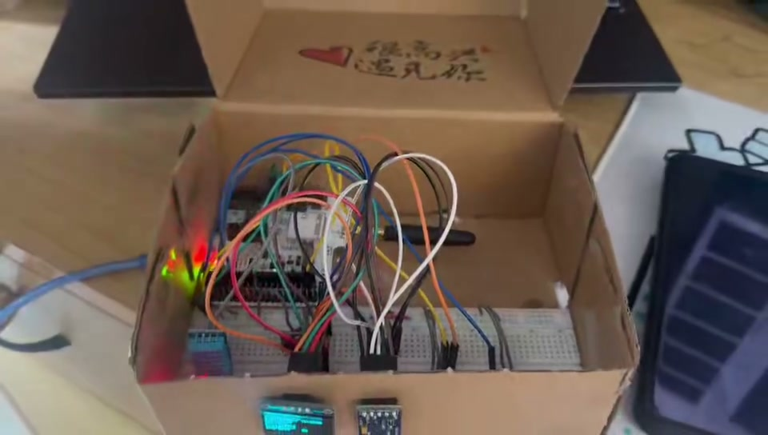
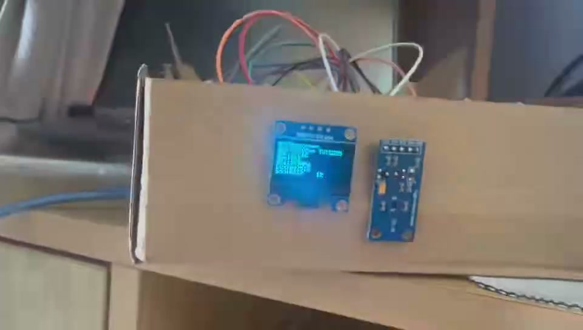
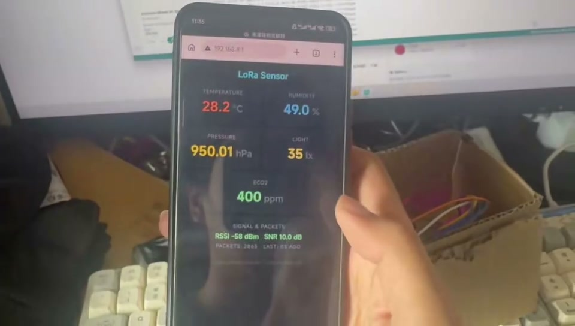
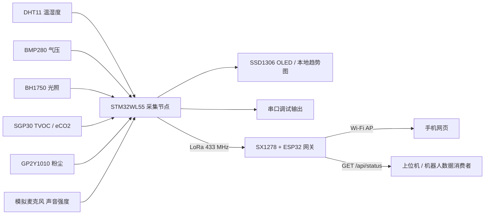

# 智慧城市环境监测系统

基于 **STM32WL55 + LoRa + ESP32** 的多传感器环境监测原型：STM32 采集环境数据并在 OLED 显示，通过 LoRa 发给 ESP32 网关；手机可连接网关热点查看网页，其他软件可通过 JSON 接口读取带有效性标记的数据。

**演示视频：[系统讲解与实物演示（约 3 分 08 秒）](docs/media/system-demo.mp4) · [实物接线短片（约 18 秒）](docs/media/hardware-demo.mp4)**

| 实物与接线 | OLED 显示 | 手机网页 |
| --- | --- | --- |
|  |  |  |

以上均为原始演示视频的实际画面，展示录制时的原型。新加入的 v1 协议、有效性标记和 JSON 接口仍需使用本次固件上板验证。

## 系统架构



当前无线链路传输温度、湿度、气压、光照和 eCO2 五项；TVOC、粉尘和声音强度仅在采集节点处理，尚未加入无线帧。项目目前是单采集节点、单接收网关设计。

## 已实现功能与展示素材

- DHT11、BMP280、BH1750、SGP30、GP2Y1010、模拟麦克风采集。
- OLED 数值页及温度、湿度、光照、粉尘历史趋势页，按键切换。
- LoRa 点对点传输，ESP32 热点与每 2 秒刷新的手机仪表盘。
- v1 无线协议：逐项有效位、采集序号、采集开始时的开机计时、发送前数据年龄。
- `GET /api/status`：五项结构化读数、逐项可用状态、数据年龄、RSSI/SNR 和收包计数。

展示素材已整理至 [docs/media](docs/media/)：两段原始视频及三张视频截图。实物、OLED、手机网页截图分别取自系统演示的 **01:53、01:59、03:01**；实物接线短片提供补充的近距离视角。视频中的讲解幻灯片保留录制时的内容，当前无线帧格式和功能范围以本文及源码为准。

已有说明文档：[智慧城市环境监测系统_技术文档.docx](智慧城市环境监测系统_技术文档.docx)。部分历史注释或文档可能与当前接线不同，以以下表格及实现代码为准。原 [readme.txt](readme.txt) 保留为 ST UART 示例的来源说明。

## 硬件与接线

采集节点工程目标为 **NUCLEO-WL55JC / STM32WL55JCIx Cortex-M4**，接收端使用 ESP32 与 SX1278。下表为信号接线；各模块电源按具体模块规格连接，所有模块共地，进入 MCU 的数字及模拟信号须满足对应引脚电平要求。

| 模块 / 信号 | STM32 引脚 | 说明 |
| --- | --- | --- |
| DHT11 DATA | PB3 | 单总线 |
| BMP280 SDA / SCL | PB7 / PB8 | I2C1，7 位地址 `0x76` |
| BH1750 SDA / SCL | PB7 / PB8 | I2C1，7 位地址 `0x23` |
| SSD1306 SDA / SCL | PB7 / PB8 | I2C1，7 位地址 `0x3C`，128×64 |
| SGP30 SDA / SCL | **PA15 / PA12** | 软件 I2C，7 位地址 `0x58`；不与 I2C1 共总线 |
| GP2Y1010 Vo / LED 控制 | PB13 / PB1 | ADC1_IN0 / GPIO |
| MAX9814 或 MAX4466 输出 | PB12 | ADC1_IN1；输出为相对声音强度，非校准声压级 |
| 串口 TX / RX | PA2 / PA3 | USART2，可经 ST-Link 虚拟串口查看 |
| SWDIO / SWCLK | PA13 / PA14 | ST-Link 烧录调试 |
| 切页按键 | PC6 | 代码使用 BSP `BUTTON_SW3` |

| SX1278 信号 | ESP32 引脚 |
| --- | --- |
| NSS / CS | GPIO5 |
| SCK | GPIO18 |
| MOSI | GPIO23 |
| MISO | GPIO19 |
| RST | GPIO2 |
| DIO0 | GPIO4 |

两端射频参数须一致：433 MHz、SF7、125 kHz、CR 4/5、前导码 8、显式包头、CRC 开启。发射端功率配置为 14 dBm。接线依据见 `Src/i2c.c`、`Src/soft_i2c.c`、`Src/adc.c` 及 ESP32 草图。

## 开发环境与运行

### STM32 采集节点

1. 使用 Keil MDK 打开 `MDK-ARM/UART_Printf.uvprojx`，目标为 `UART_Printf`。项目记录的编译器为 **Arm Compiler 6.16**，需要 STM32WL 对应设备支持包。
2. Build 编译后，通过板载 ST-Link 下载并运行。
3. USART2 串口配置为 **115200、7 数据位、奇校验、1 停止位、无流控（7-O-1）**。
4. 观察传感器初始化日志、OLED 和 LoRa 发送状态。

仓库同时保留 `UART_Printf.ioc`、`STM32CubeIDE/`、`EWARM/`；它们源于 ST 示例，使用其他 IDE 前需核对自定义驱动源文件和头文件路径是否完整。主循环末尾延时为 800 ms，另有传感器读取、显示和阻塞发送耗时，**并非固定 2 秒采样**。

### ESP32 接收网关

1. 在 Arduino IDE 安装 Espressif ESP32 开发板包和 **LoRa by Sandeep Mistry** 库；`WiFi`、`WebServer` 随 ESP32 开发板包提供。
2. 打开 `ESP32_LoRa_Receiver/ESP32_LoRa_Receiver.ino`，保留同目录 `sensor_protocol.h`，选择实际 ESP32 开发板与串口后编译上传。
3. ESP32 调试串口为 115200。按启动日志确认热点地址。
4. 手机或电脑连接热点 **LoRa-Sensor**，默认密码 **12345678**，访问 [仪表盘](http://192.168.4.1/) 或 [JSON 接口](http://192.168.4.1/api/status)。SSID 和密码在草图顶部修改。

已安装 Arduino CLI 的环境可执行：

```sh
arduino-cli compile --fqbn esp32:esp32:esp32 ESP32_LoRa_Receiver
```

## 无线协议与数据有效性

v1 固定 **28 字节**，多字节整数均为大端序，双方共用 `ESP32_LoRa_Receiver/sensor_protocol.h`，STM32 经 `Inc/sensor_protocol.h` 引用同一定义，避免编解码漂移。

| 偏移 | 长度 | 字段 | 含义 |
| --- | --- | --- | --- |
| 0 | 2 | magic | ASCII `SC`（`0x53 0x43`） |
| 2 | 1 | version | `1` |
| 3 | 1 | valid_mask | bit0 温度、bit1 湿度、bit2 气压、bit3 光照、bit4 eCO2；bit5–7 必须为 0 |
| 4 | 4 | sequence | uint32，每轮发包尝试递增，包括发送失败；重启归零 |
| 8 | 4 | sample_uptime_ms | uint32，采集开始时的 STM32 开机毫秒数 |
| 12 | 4 | source_age_ms | uint32，从本轮采集开始到打包发送前的毫秒数 |
| 16 | 2 | temperature_deci_c | int16，温度 ×10，°C |
| 18 | 2 | humidity_deci_pct | uint16，相对湿度 ×10，% |
| 20 | 4 | pressure_pa | uint32，Pa |
| 24 | 2 | light_lux | uint16，lx |
| 26 | 2 | eco2_ppm | uint16，ppm |

有效位每轮重新生成，只有本轮读取成功才置位；温湿度共同依赖 DHT11 返回值，气压还沿用至少 30000 Pa 的原有检查，eCO2 要求 SGP30 初始化成功、读取与 CRC 成功并经过代码定义的 15 秒预热期。失败项在无线帧内置零，**零本身不表示失败**，必须检查有效位。

接收端拒绝错误长度、魔数、版本、保留位和标为有效但超过 100% 的湿度，不用这些包更新数据或刷新时间。`valid_packets` 仅指格式通过的包数，不代表所有传感器有效；`invalid_packets` 统计应用层拒绝的包，不包含无线芯片已丢弃的 CRC 错误包。

接收端年龄为 `source_age_ms + 距上次成功解析的接收时间`，超过 **10000 ms** 后读数不可用；年龄相加采用饱和处理，超时状态锁存到下一有效格式帧。年龄不包含无线传输及潜在排队延迟，不是精确端到端测量。`sample_uptime_ms` 不是 Unix 时间，两端开机计时不能直接相减；uint32 开机计时和序号会回绕。

兼容旧 **12 字节**帧的解析，但它没有源端有效性信息：接口返回 `protocol_version: 0`、`source_valid_mask: null`，五项读数均为 `null`，网页提示 `UNKNOWN`。建议先更新 ESP32，再更新 STM32；旧接收固件不能正确消费新帧。协议无节点身份、认证或防重放，序号仅供诊断，当前接收端不做去重或多节点分流。

## JSON 接口

`GET /api/status` 返回 HTTP 200、`application/json`、`Cache-Control: no-store`。即使无样本或超时也返回状态对象，调用方必须检查 `valid` 和读数是否为 `null`。

示例（字段说明用数据，非实测记录）：

```json
{
  "schema": "sensor-status-v1",
  "has_sample": true,
  "protocol_version": 1,
  "stale": false,
  "age_ms": 350,
  "received_age_ms": 250,
  "sequence": 7,
  "sample_uptime_ms": 200,
  "source_age_ms": 100,
  "source_valid_mask": 31,
  "valid": {
    "temperature_c": true,
    "humidity_pct": true,
    "pressure_pa": true,
    "light_lux": true,
    "eco2_ppm": true
  },
  "valid_packets": 8,
  "invalid_packets": 0,
  "temperature_c": 25.3,
  "humidity_pct": 55.0,
  "pressure_pa": 101325,
  "light_lux": 0,
  "eco2_ppm": 500,
  "rssi_dbm": -75,
  "snr_db": 8.5,
  "authenticated": false,
  "safety_control_eligible": false
}
```

- 未收到包：`has_sample=false`、`stale=true`，年龄、协议信息和读数为 `null`。
- 单项读取失败：该项 `valid=false`、读数 `null`；其他有效项仍可使用。
- 超时：`stale=true`，所有 `valid=false`、读数 `null`；保留序号、源端有效位和上次信号信息供诊断。
- 所有传感器失败但持续收到新包：可能 `stale=false`，但所有 `valid=false`。链路新鲜与测量成功是两个独立条件。

```python
import json
from urllib.request import urlopen

with urlopen("http://192.168.4.1/api/status", timeout=3) as response:
    state = json.load(response)
if state["valid"]["temperature_c"]:
    print("温度：", state["temperature_c"], "°C")
else:
    print("当前没有可用的温度读数")
```

eCO2 是等效 CO2 估计值，声音及粉尘也尚未完成工程标定。有效位表示本轮采集状态，不等于计量精度保证；现有本地 OLED/历史日志尚未接入逐项无效标记。SGP30 主循环测量节拍仍需在硬件联调时校准。接口沿用 `authenticated=false` 和 `safety_control_eligible=false`，当前数据适合展示和算法实验，尚未完成机器人安全决策链路验证。

## 验证与目录

2026-10-18 本地验证：Keil / Arm Compiler 6.16 构建通过（0 错误、0 警告）；ESP32 开发板包 3.3.10 + LoRa 0.8.0、目标 `esp32:esp32:esp32` 编译通过（程序空间 73%、全局变量内存 14%）；下述主机协议测试及 12 个接收端/API 场景通过。尚未烧录本次固件或完成实物联调。

在有 Python 3、GCC、G++ 的主机运行：

```sh
python tests/run_tests.py
```

测试使用固定无线字节向量检查大小端、负温度、无效字段清零和错误帧；以主机替身执行真实 ESP32 草图，检查 JSON、网页和 12 个状态场景，包括无包、正常、部分失败、全失败、旧协议、超时边界、计时器回绕及年龄溢出。此类测试不能替代实物射频联调。

上板验收建议：正常收包后断开单个传感器，确认对应字段变 `null`；恢复接线确认有效位恢复；关闭 STM32 超过 10 秒确认全部超时；重启两端检查启动无包状态和 SGP30 预热状态。编译产物上传与上述实物操作需在实际设备上完成。

| 路径 | 用途 |
| --- | --- |
| `Src/`、`Inc/` | STM32 主程序、传感器、OLED、LoRa 驱动 |
| `ESP32_LoRa_Receiver/` | 网关草图与共用协议定义 |
| `MDK-ARM/` | Keil 工程 |
| `Drivers/`、`Middlewares/`、`Utilities/` | ST HAL / CMSIS / BSP 与中间件 |
| `tests/` | 不依赖设备的协议及接收端回归测试 |
| `docs/media/` | 原始演示视频、实物及界面截图 |

ST 提供文件的版权和许可声明保留在原文件中；本文不变更第三方代码许可。
